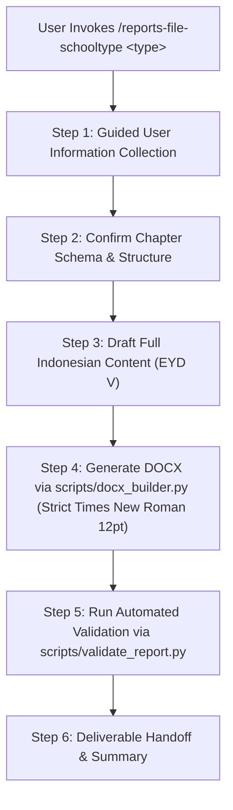

# Indonesian School & University Report Generator (`reports-file-schooltype`)

This skill provides an end-to-end workflow for writing, structuring, formatting, editing, and exporting formal Indonesian school and university reports in editable Microsoft Word (`.docx`) format.

---

## 1. Strict Formatting & Typography Restrictions

- **Font Family**: **Times New Roman ONLY**. No other font family (such as Arial, Calibri, or Helvetica) is allowed anywhere in the document.
- **Base Font Size**: **12 pt** for all standard body text, sub-headings, and preliminary signatures.
- **Heading 1**: Times New Roman 14 pt Bold Uppercase Centered.
- **Line Spacing**: 1.5 lines for all body paragraphs.
- **Paragraph Spacing**: 0 pt before, 6 pt after. Justified alignment (`justify`). First line indent: 1.27 cm (0.5 in).
- **Paper Size & Margins**: A4 Paper (21.0 x 29.7 cm), Top: 4.0 cm, Left: 4.0 cm, Bottom: 3.0 cm, Right: 3.0 cm (Standard 4-4-3-3 binding rule).

---

## 2. Usage Interface

Primary invocation syntax:
```text
/reports-file-schooltype <report-type>
```

Supported report types:
- `pkl`: Laporan Praktik Kerja Lapangan / Magang / Prakerin (SMK, D3, S1).
- `skripsi`: Skripsi / Tugas Akhir / Thesis (D4, S1, S2).
- `makalah`: Makalah Akademik / Paper Class (SMP, SMA, SMK, S1).
- `proposal`: Proposal Penelitian / Proposal Kegiatan.
- `proyek`: Laporan Proyek / Project Report.
- `laporan_kegiatan`: Laporan Kegiatan Sekolah / Instansi (RKAS, event report).
- `research`: Laporan Penelitian / Research Report.
- `paper`: Scientific Paper / Jurnal.

---

## 3. Mandatory User Information Collection (Guided Interview)

Before generating a complete report, the skill **must** collect essential details from the user:
1. **Report Type & Title**: Specific title, purpose, and preferred language (Default: Indonesian).
2. **Institutional Identity**: School/University name, Faculty, Department/Program Keahlian, City, Year.
3. **Author Identity**: Student/Author full name, NISN/NIM, Class/Semester.
4. **Target Entity / Company**: Company/DUDI name, department, address, internship period.
5. **Report Content & Activity Data**: Daily activities, theoretical background, troubleshooting/problems solved, research results.
6. **Signatories**: Names and titles of Headmaster/Dean, Academic Supervisor, Industry Supervisor.
7. **Attachments & Images**: Logos, activity photos, diagrams, certificates, daily logs.

---

## 4. Execution Workflow



### Step 1 — Guided User Information Collection
- Greet the user in professional Indonesian.
- Confirm the target report type and present a brief checklist of required details.

### Step 2 — Confirm Chapter Schema & Structure
- Consult `references/report-type-registry.md` to load the standard chapter outline.

### Step 3 — Draft Full Indonesian Content (EYD V)
- Write complete formal academic text in Indonesian using passive voice.

### Step 4 — Generate DOCX via `scripts/docx_builder.py`
- Execute `scripts/docx_builder.py` enforcing strict Times New Roman typography and 4-4-3-3 cm margins.

### Step 5 — Run Automated Validation
- Run `scripts/validate_report.py` against the generated `.docx` file.

### Step 6 — Deliverable Handoff & Summary
- Report completion to the user, providing a summary and listing any action items.
